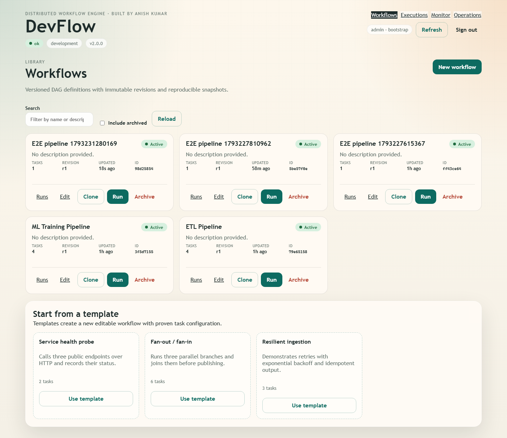
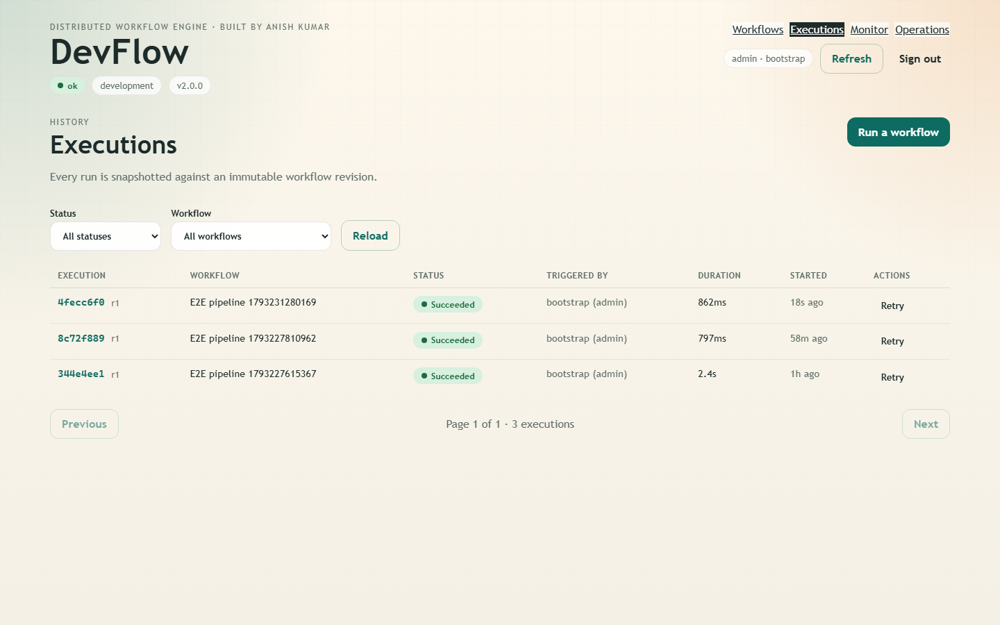
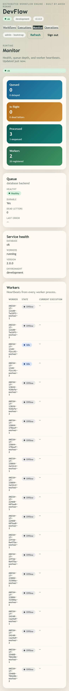
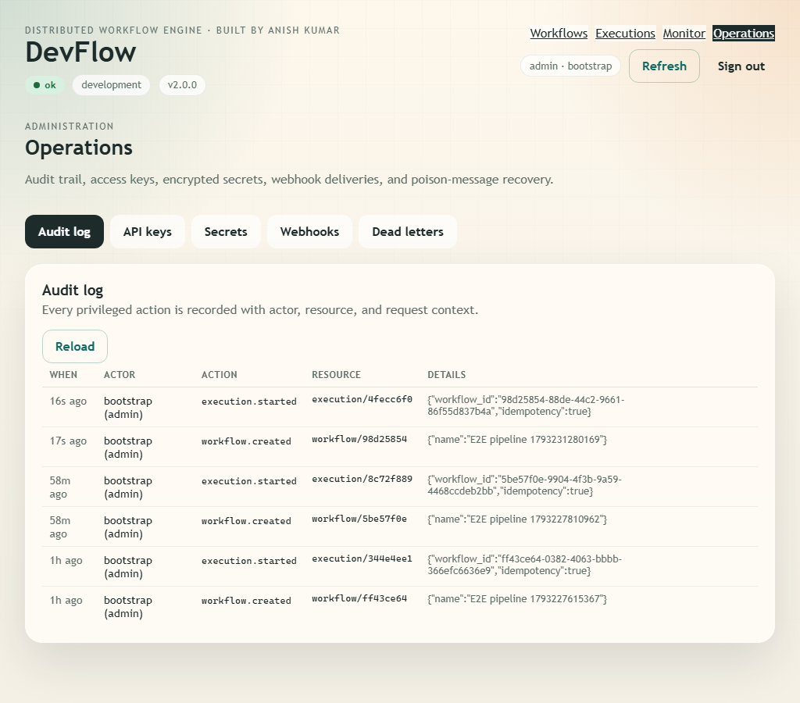

# DevFlow

Distributed workflow and job-processing engine with a strict `Web → API → Queue → Worker → DB → UI` topology. Define DAG workflows, run them asynchronously, watch task lifecycles in real time, and operate queue/worker health from a React control plane.

Created and maintained by **Anish Kumar**.

[](https://github.com/Anish17-Shanu/DevFlow/actions/workflows/ci.yml)
[](LICENSE)
[](backend/requirements.txt)
[](frontend/package.json)



## What it does

- **DAG workflows** with dependency validation, immutable revisions, cloning, import/export, and templates.
- **Durable queue** in PostgreSQL using `SELECT … FOR UPDATE SKIP LOCKED`, leases, renewal, stale-lease recovery, priority aging, delayed jobs, dead letters, and replay.
- **Dedicated workers** with unique instance IDs, graceful drain, heartbeat health checks, watchdog recovery, and per-workflow concurrency limits.
- **Execution control** — cancel, retry, per-task retry/skip, idempotency keys, and snapshot isolation so edits never mutate running work.
- **Multi-tenant security** — hashed API keys, viewer/operator/admin RBAC, tenant-scoped queries, per-key rate limiting, audit log, and encrypted secret references (`{{secret:name}}`).
- **Real-time UI** — websocket updates with polling fallback, execution history/search, DAG visualization, responsive layouts from 360 px to 1440 px.
- **Operations** — Prometheus metrics, structured JSON logs with request IDs, OpenTelemetry hooks, webhooks with retries, scheduled runs, retention jobs, and support diagnostics.
- **Deployment** — hardened Docker Compose stack, Kubernetes manifests (HPA, PDB, NetworkPolicy, TLS ingress), backup/restore scripts, alerts, and a Grafana dashboard.

Project status and remaining gaps are tracked in the living [roadmap](ROADMAP.md). Release gates live in the [production checklist](docs/PRODUCTION_CHECKLIST.md).

## Architecture

```text
React UI ──HTTP/WS──► FastAPI API ──enqueue──► PostgreSQL queue ──lease──► Worker processes
     │                     │                        │                          │
     └──── /api/v1 ────────┘                        └──────── logs, tasks, outbox ─────┘
```

- [Architecture guide](docs/ARCHITECTURE.md)
- [Architecture decision records](docs/adr/README.md)
- [Generated API reference](docs/API.md)
- [Deployment guide](docs/DEPLOYMENT.md)
- [Operations runbook](docs/RUNBOOK.md)
- [Troubleshooting](docs/TROUBLESHOOTING.md)
- [Capacity notes](docs/CAPACITY.md)
- [Contributing](docs/CONTRIBUTING.md)

## Quick start

Requires **Python 3.12–3.14** and **Node.js 20+**.

### 1. API and inline workers

```bash
python -m venv .venv
.venv\Scripts\activate            # Windows
# source .venv/bin/activate       # macOS / Linux
pip install -r backend/requirements-dev.txt
uvicorn backend.main:app --reload --port 8000
```

The first boot creates the schema, seeds a default admin key, and seeds sample workflows. In development the bootstrap key is `devflow-dev-key`.

### 2. UI

```bash
cd frontend
npm install
npm run dev
```

Open `http://localhost:5173` and sign in with `devflow-dev-key`. Set `VITE_API_BASE_URL` or `VITE_PROXY_TARGET` if the API is not on `localhost:8000`.

### 3. Dedicated worker (recommended)

```bash
python -m backend.worker_main
```

Set `DEVFLOW_INLINE_WORKERS_ENABLED=false` on the API when running dedicated workers.

## Screenshots

| Workflows (1440 px) | Execution detail (1440 px) |
| --- | --- |
|  |  |

| Monitor (390 px) | Operations (1024 px) |
| --- | --- |
|  |  |

More widths: [360](docs/screenshots/workflows-360.png), [390](docs/screenshots/workflows-390.png), [768](docs/screenshots/workflows-768.png), [1024](docs/screenshots/workflows-1024.png), [1440](docs/screenshots/workflows-1440.png).

## API

All HTTP routes are under `/api/v1` and require `X-API-Key` (or `Authorization: Bearer`). WebSocket connections require `?api_key=` or the `X-API-Key` header. Errors share one envelope:

```json
{
  "code": "validation_error",
  "message": "Request validation failed.",
  "request_id": "5f0c…",
  "details": [{ "loc": ["body", "tasks"], "msg": "…", "type": "…" }]
}
```

| Method | Path | Purpose |
| --- | --- | --- |
| `GET` | `/api/v1/auth/me` | Current principal, tenant, and role |
| `GET/POST` | `/api/v1/auth/keys` | List, create API keys (admin) |
| `DELETE` | `/api/v1/auth/keys/{id}` | Revoke an API key (admin) |
| `GET/POST` | `/api/v1/workflows` | List (paginated) and create workflows |
| `GET/PATCH/DELETE` | `/api/v1/workflows/{id}` | Read, update (new revision), archive |
| `POST` | `/api/v1/workflows/{id}/run` | Start an execution (supports `Idempotency-Key`) |
| `POST` | `/api/v1/workflows/{id}/clone` | Clone a workflow |
| `GET` | `/api/v1/workflows/{id}/revisions` | Immutable revision history |
| `GET` | `/api/v1/workflows/{id}/export` | JSON export; `POST /workflows/import` restores it |
| `GET/POST` | `/api/v1/workflows/{id}/schedules` | List or create cron-style schedules |
| `GET` | `/api/v1/workflows/templates` | Starter workflow templates |
| `GET` | `/api/v1/executions` | Paginated history with status/workflow filters |
| `GET` | `/api/v1/executions/{id}` | Execution detail |
| `GET` | `/api/v1/executions/{id}/tasks` | Task states and attempts |
| `GET` | `/api/v1/executions/{id}/logs` | Bounded, offset-paginated logs |
| `POST` | `/api/v1/executions/{id}/cancel` | Cancel pending work |
| `POST` | `/api/v1/executions/{id}/retry` | Retry an execution as a new run |
| `POST` | `/api/v1/executions/{id}/tasks/{task}/retry` | Retry one task branch |
| `POST` | `/api/v1/executions/{id}/tasks/{task}/skip` | Skip one task branch |
| `GET` | `/api/v1/queue/status` | Queue depth, in-flight, delayed, dead letters |
| `GET` | `/api/v1/queue/dead-letters` | Inspect dead-lettered jobs |
| `POST` | `/api/v1/queue/dead-letters/{job}/replay` | Replay a dead-lettered job |
| `GET` | `/api/v1/workers/status` | Worker states and heartbeats |
| `GET` | `/api/v1/system/snapshot` | Runtime snapshot |
| `GET` | `/api/v1/diagnostics` | Support diagnostics (admin) |
| `GET/POST/DELETE` | `/api/v1/secrets` | Encrypted secret references (admin) |
| `GET/POST/DELETE` | `/api/v1/webhooks` | Webhook endpoints and delivery history |
| `GET` | `/api/v1/audit` | Privileged-action audit log (admin) |
| `GET` | `/health`, `/health/live`, `/health/ready` | Liveness and readiness probes |
| `GET` | `/metrics` | Prometheus metrics |
| `WS` | `/ws/executions/{id}` | Live execution events |

Full request/response schemas: [docs/API.md](docs/API.md). It is generated from OpenAPI and checked in CI for drift.

### Task handlers

| Type | Key config | Behaviour |
| --- | --- | --- |
| `sleep` | `duration_ms` | Simulated work; used by samples and tests |
| `echo` | `message` | Emits a log line and succeeds |
| `http` | `url`, `method`, `headers`, `body`, `expected_status` | Outbound HTTP call with private-network guard |
| `fail` | `message` | Deterministic failure for retry/dead-letter testing |

Retries, priority, delayed start, and timeouts are lifecycle config (`max_retries`, `backoff_seconds`, `priority`, `delay_seconds`, `timeout_seconds`). Secrets are referenced as `{{secret:name}}` and never stored in workflow JSON.

## Testing

```bash
# Backend: lint, format, unit + integration, coverage gate
ruff check backend migrations
ruff format --check backend migrations
python -m pytest --cov=backend --cov-report=term

# Frontend: unit tests with coverage and production build
cd frontend
npm run test:coverage
npm run build

# Browser end-to-end + responsive audit (Playwright, built bundle)
npm run test:e2e
```

PostgreSQL-specific tests run when `DEVFLOW_TEST_POSTGRES_URL` is set; CI runs the full suite against PostgreSQL 16, including migration up/down/up. See [docs/CAPACITY.md](docs/CAPACITY.md) for measured load-test results and [docs/RUNBOOK.md](docs/RUNBOOK.md) for recovery drills.

## Docker

```bash
# Required for the production-oriented Compose stack
export POSTGRES_PASSWORD=...
export DEVFLOW_BOOTSTRAP_API_KEY=...
export DEVFLOW_SECRET_ENCRYPTION_KEY=...

docker compose up --build
```

- UI: `http://localhost:8080`
- API: `http://localhost:8000`
- Liveness: `http://localhost:8000/health/live`
- Readiness: `http://localhost:8000/health/ready`

The stack includes PostgreSQL, a one-off migration job, the API, a dedicated worker with heartbeat health, and an unprivileged nginx frontend. All five services were verified healthy, with the migration exiting 0 and `scripts/smoke_test.sh` passing against the containerized API. See [docs/DEPLOYMENT.md](docs/DEPLOYMENT.md) for TLS, Kubernetes, autoscaling, backups, and environment separation.

## Configuration

Copy [.env.example](.env.example) to `.env`. The most important variables:

| Variable | Purpose |
| --- | --- |
| `DEVFLOW_ENVIRONMENT` | `development`, `staging`, or `production`; production enables strict validation |
| `DEVFLOW_DATABASE_URL` | `postgresql+asyncpg://…` in deployed environments, SQLite locally |
| `DEVFLOW_BOOTSTRAP_API_KEY` | First admin key; must be ≥24 chars and non-default in production |
| `DEVFLOW_SECRET_ENCRYPTION_KEY` | Fernet key for task secret references |
| `DEVFLOW_CORS_ORIGINS` | Comma-separated frontend origins; required in production |
| `DEVFLOW_WORKER_COUNT` | Worker coroutines per process |
| `DEVFLOW_INLINE_WORKERS_ENABLED` | Run workers inside the API (development only) |
| `DEVFLOW_AUTO_MIGRATE` | Must be `false` in production; migrations run as a release job |
| `DEVFLOW_QUEUE_LEASE_SECONDS` | Job lease duration; must exceed heartbeat cadence |
| `DEVFLOW_RATE_LIMIT_REQUESTS_PER_MINUTE` | Per-key request budget |
| `DEVFLOW_MAX_REQUEST_BODY_BYTES` | Hard request body cap (default 1 MiB) |
| `DEVFLOW_REALTIME_BUS` | `auto` fans websocket updates across API replicas via Postgres `LISTEN/NOTIFY`; `off` keeps delivery local |
| `DEVFLOW_DOCS_ENABLED` | Expose `/docs` and `/redoc` |

Full list with defaults: [.env.example](.env.example) and [backend/core/config.py](backend/core/config.py).

## Operations

- **Health:** `/health/live` for restart decisions, `/health/ready` for traffic routing.
- **Metrics:** request rate/latency, queue depth/in-flight/delayed/dead-letter, worker online, task wait/duration, execution outcomes.
- **Alerts:** [deploy/observability/alerts.yml](deploy/observability/alerts.yml) (7 SLO alerts with runbook links).
- **Dashboard:** [deploy/observability/grafana-dashboard.json](deploy/observability/grafana-dashboard.json).
- **Backup/restore:** [scripts/backup_postgres.sh](scripts/backup_postgres.sh), [scripts/restore_postgres.sh](scripts/restore_postgres.sh).
- **On-call:** [docs/RUNBOOK.md](docs/RUNBOOK.md) (SLOs, RPO 15 min / RTO 1 h, escalation).

## Security

Report vulnerabilities privately following [SECURITY.md](SECURITY.md). The API enforces authentication, RBAC, tenant isolation, rate limiting, request caps, security headers, and audit logging; deployments add TLS, network policies, non-root containers, vulnerability scanning, and signed images.

## License

MIT © 2026 Anish Kumar. See [LICENSE](LICENSE).
